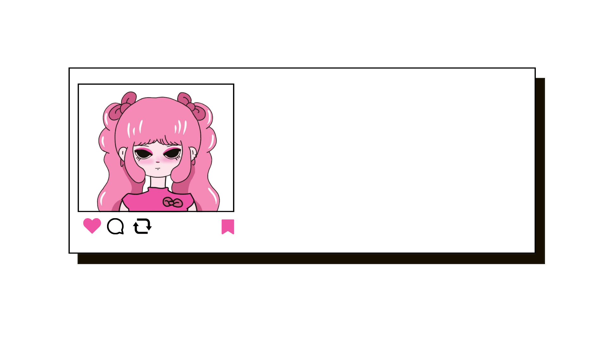

  <!-- Status Line (Pixelated & Static) -->
  

    
  

  <!-- Animated Header Card -->
  

   

  <!-- Animated Pixel Greeting -->
  

    
  

<!--Role Banner -->
  

    
     
    
  

  <!-- Divider -->
  

    
  

<!-- GitHub Streak Card (Pink Theme) -->
  

    
  

  <!-- Whimsical Pink Activity Breakdown -->
  

    
  

